# Heart Disease Risk Prediction: End-to-End MLOps Pipeline

**Course:** AIMLCZG523 MLOps, Assignment 01
**Repository:** https://github.com/<your-username>/MLOps_Assgn_1

---

## 1. Overview

This project builds a machine learning classifier that predicts heart disease risk from 13 clinical features (UCI Heart Disease dataset, Cleveland subset) and delivers it as a production-style service. The pipeline covers data acquisition and validation, model training with experiment tracking, automated testing and CI/CD, containerisation, Kubernetes deployment, and monitoring.

| Area | Tools |
|---|---|
| Data and modelling | pandas, scikit-learn (Logistic Regression, Random Forest, Gradient Boosting) |
| Experiment tracking | MLflow (SQLite backend, Model Registry) |
| Testing and linting | pytest, pytest-cov, ruff |
| CI/CD | GitHub Actions, GitHub Container Registry (GHCR) |
| Serving | FastAPI, Pydantic, Uvicorn |
| Containerisation | Docker (multi-stage, non-root) |
| Orchestration | Kubernetes (Docker Desktop), Kustomize |
| Monitoring | Prometheus metrics, JSON structured logging, Grafana |

---

## 2. Architecture

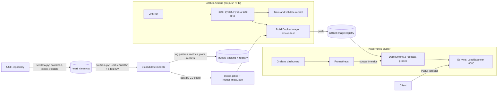

**Flow:** raw data is downloaded and validated, then three models are tuned and compared, with every run logged to MLflow. The best pipeline (preprocessing and model together) is saved with its metadata. On every push, GitHub Actions lints, tests, retrains, and builds and smoke-tests a Docker image, which is published to GHCR. Kubernetes runs two replicas behind a load balancer, and Prometheus and Grafana monitor service and model behaviour.

---

## 3. Setup and Installation

**Requirements:** Python 3.10–3.12, Git, Docker Desktop (with Kubernetes enabled for deployment).

```bash
git clone https://github.com/khartodenikhil/MLOps_Assgn_1
cd MLOps_Assgn_1
python -m venv .venv
# Windows: .venv\Scripts\activate    macOS/Linux: source .venv/bin/activate
pip install -r requirements-dev.txt
```

| Task | Command |
|---|---|
| Download and clean data | `python -m src.data` |
| Train and track experiments | `python -m src.train` |
| View MLflow UI | `mlflow ui --backend-store-uri sqlite:///mlflow.db` |
| Predict from the command line | `python -m src.predict --input samples/patients.json` |
| Run tests and lint | `pytest --cov` and `ruff check .` |
| Reproduce from scratch | `scripts\reproduce.ps1` (Windows) or `bash scripts/reproduce.sh` |
| Run the API locally | `uvicorn src.api.main:app --reload` (open `/docs`) |
| Build and run the container | `docker build -t heart-disease-api:v1 .` then `docker run -p 8000:8000 heart-disease-api:v1` |
| Deploy to Kubernetes | `kubectl apply -k k8s` (API at `http://localhost:8080`) |

Dependencies are pinned in `requirements-serve.txt` (serving), `requirements.txt` (training) and `requirements-test.txt` (testing).

---

## 4. Data Acquisition and EDA

**Dataset:** UCI Heart Disease, Cleveland subset: 303 patients, 13 features, and a target `num` (0–4).

**Acquisition and cleaning (`src/data.py`):**
- The download script fetches the raw file from UCI, with a fallback to the zip archive.
- `?` markers are parsed as missing values. There are 6 missing values in total (4 in `ca`, 2 in `thal`), and those rows were dropped, leaving 297 rows. Dropping avoids leaking imputation statistics into the test set. The model pipeline still contains imputers, so the API can handle missing optional fields at inference time.
- The target was converted to binary: 0 means no disease, and 1–4 means disease present.
- A validation function enforces physiological ranges (for example, age 1–120 and cholesterol 50–700) and allowed category codes, and fails loudly on bad data.

**EDA (`notebooks/01_eda.ipynb`, figures in `reports/figures/`):**
- **Class balance:** about 54% no disease and 46% disease. The classes are close to balanced, so accuracy is meaningful, but recall and ROC-AUC are also tracked.
- **Strongest signals:** chest pain type (`cp`, especially asymptomatic = 4), number of major vessels (`ca`), thalassemia (`thal`), exercise-induced angina (`exang`), ST depression (`oldpeak`) and maximum heart rate (`thalach`, which is lower in disease cases).
- **Weak signals:** cholesterol and fasting blood sugar separate the classes poorly.
- **Implications:** numeric features need scaling, and categorical codes are nominal, so they need one-hot encoding.

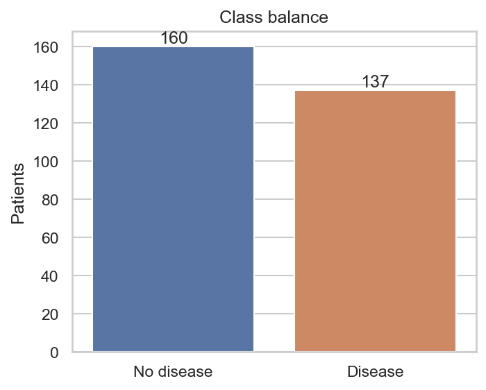
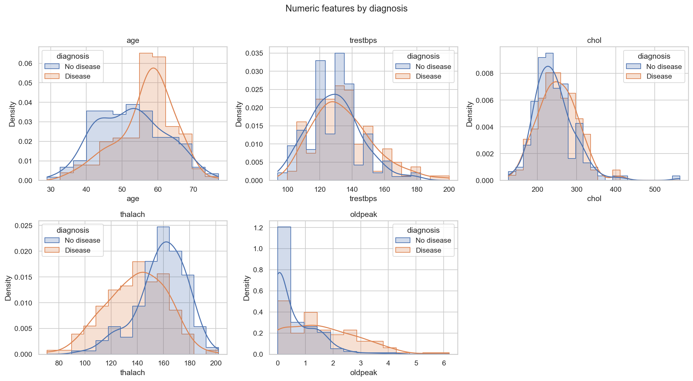
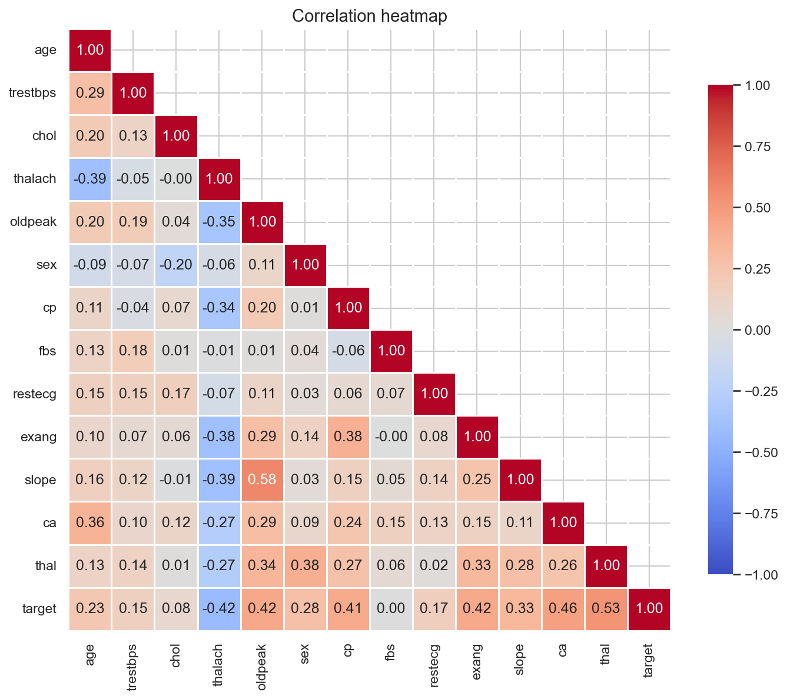

---

## 5. Feature Engineering and Modelling Choices

**Preprocessing (`src/features.py`):** a single scikit-learn `ColumnTransformer` inside a `Pipeline`:
- Numeric features (`age`, `trestbps`, `chol`, `thalach`, `oldpeak`): median imputation, then `StandardScaler`
- Categorical features (`sex`, `cp`, `fbs`, `restecg`, `exang`, `slope`, `ca`, `thal`): most-frequent imputation, then `OneHotEncoder(handle_unknown="ignore")`

Keeping preprocessing inside the pipeline means it is fitted only on the training folds, which prevents leakage, and the exact same transformations run in training and serving, which prevents training/serving skew.

**Models and tuning (`src/train.py`):**
- An 80/20 stratified train/test split with seed 42
- `GridSearchCV` with stratified 5-fold cross-validation, scoring accuracy, precision, recall, F1 and ROC-AUC

| Model | Hyperparameters searched |
|---|---|
| Logistic Regression | `C` ∈ {0.01, 0.1, 1, 10}; `class_weight` ∈ {None, balanced} |
| Random Forest | `n_estimators`, `max_depth`, `min_samples_leaf`, `class_weight` |
| Gradient Boosting | `n_estimators`, `learning_rate`, `max_depth`, `subsample` |

**Results:** the full table is in `reports/model_comparison.csv`.

| Model | CV ROC-AUC | Test accuracy | Test precision | Test recall | Test ROC-AUC |
|---|---|---|---|---|---|
| Logistic Regression | _fill in_ | | | | |
| Random Forest | | | | | |
| Gradient Boosting | | | | | |

**Selection:** the final model is the one with the highest **cross-validated** ROC-AUC, never the test score, because selecting on the test set would inflate the reported performance. In a screening context a missed case (a false negative) is costlier than a false alarm, so recall was also monitored, and `--select-metric recall` is supported as an alternative.

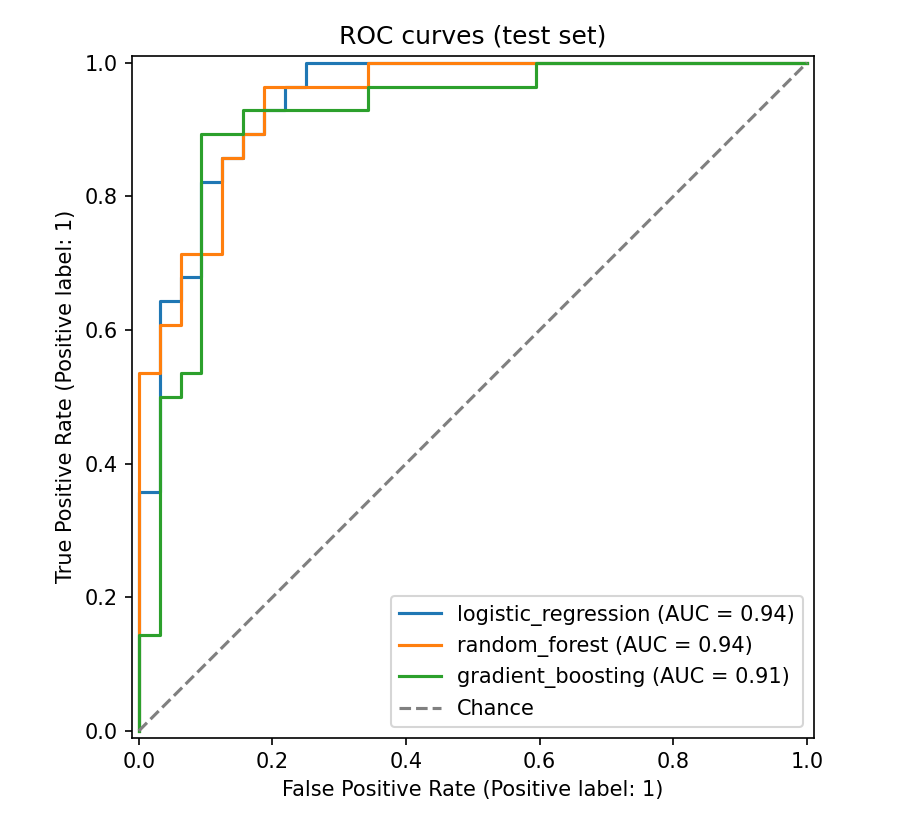

---

## 6. Experiment Tracking (MLflow)

Each training run creates a nested run structure:

```
model_selection_<metric>   parent: seed, folds, split size, git commit, data MD5 hash,
│                          ROC plot, comparison table, metrics.json
├── logistic_regression    best params, search grid, CV mean ± std, test metrics,
├── random_forest          confusion matrix, feature importance,
└── gradient_boosting      model with input signature and example
```

- With `--log-candidates`, every grid combination is logged as a child run, which allows parallel-coordinates comparison of hyperparameters.
- The selected model is registered as `heart-disease-classifier` with the alias **`champion`**, and `src/predict.py --source registry` loads it from the registry.
- The git commit and data hash tie each result to the exact code and data that produced it.

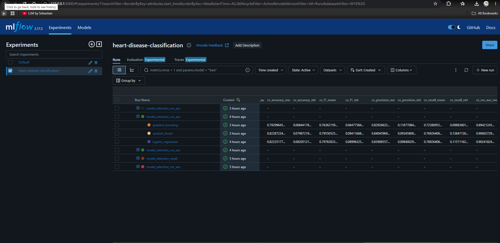
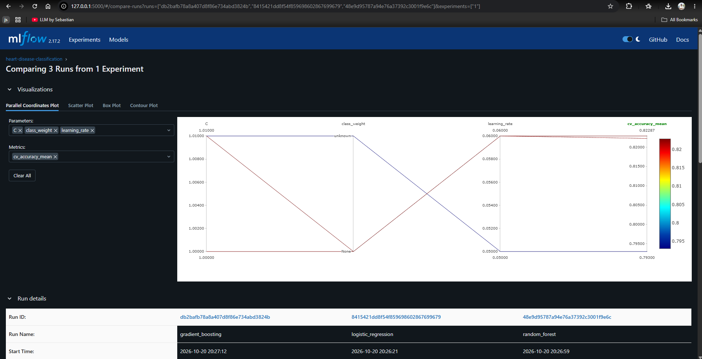
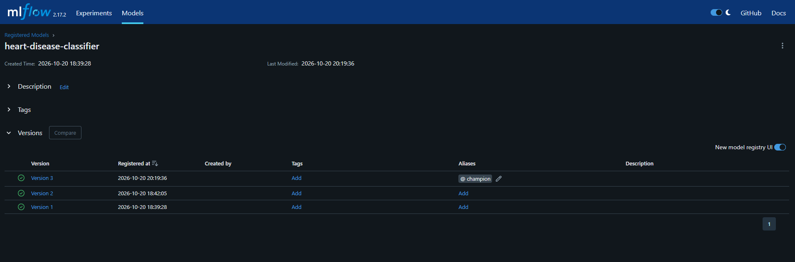

---

## 7. Packaging and Reproducibility

- `models/model.joblib` holds the complete pipeline (preprocessing and model), so it accepts raw feature values.
- `models/model_meta.json` records the model name, features, threshold, Python and scikit-learn versions, git commit, data hash and test metrics. `predict.py` warns if the installed scikit-learn version differs from the training version.
- All dependencies are pinned, and a single seed controls the split, the CV folds and every model.
- `scripts/reproduce.ps1` and `reproduce.sh` create a fresh virtual environment, reinstall, re-download, retrain and predict, then check that the metrics match the committed ones.


---

## 8. Testing and CI/CD

**Tests (`tests/`):** about 70 pytest tests run on synthetic data with mocked network calls, so they work offline.

| File | Covers |
|---|---|
| `test_data.py` | `?` parsing, binary target, missing-value strategies, duplicates, range and category validation, download |
| `test_features.py` | Output shape, scaling, one-hot encoding, imputation, unseen categories |
| `test_train.py` | Grid search returns all metrics; model beats chance |
| `test_evaluate.py` | Metrics, plot generation |
| `test_predict.py` | Output structure, threshold, invalid and unknown fields, model loading, version warning |
| `test_api.py` | Endpoints, 422 validation, 503 without a model, batch limits |

**Pipeline (`.github/workflows/ci.yml`):** runs on every push to `main`, every pull request, and on demand.

```
                                       ┌─► train  (download → validate → train → predict → compare metrics)
lint (ruff) ──► test (Py 3.10 + 3.11) ─┤
                                       └─► docker (build → run → /health + /predict smoke test → push to GHCR)
```

- Each stage is gated: a lint error or failing test stops everything downstream.
- The test results (JUnit, coverage), the trained model, the reports and the MLflow runs are uploaded as artifacts.
- The image is tagged both `latest` and with the commit SHA, so every deployment can be traced to its code.
- **Failure demonstration:** a deliberately broken test on a pull request turned the tests red and skipped the train and docker jobs, which shows the pipeline blocks bad code.

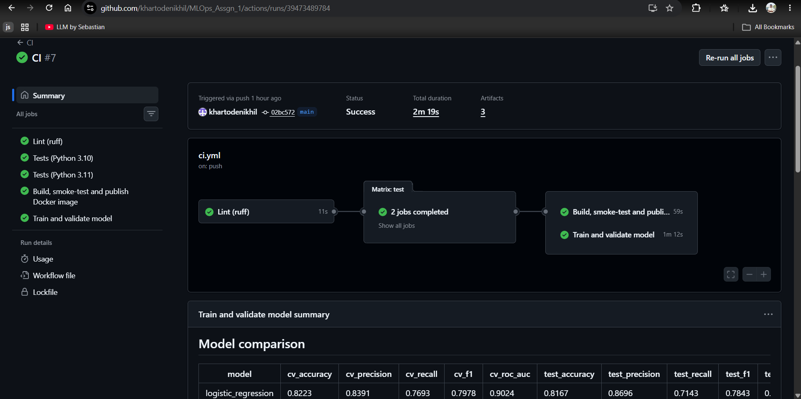
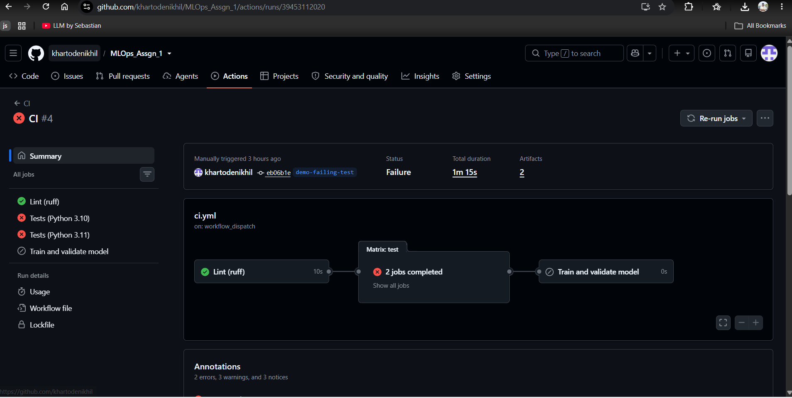
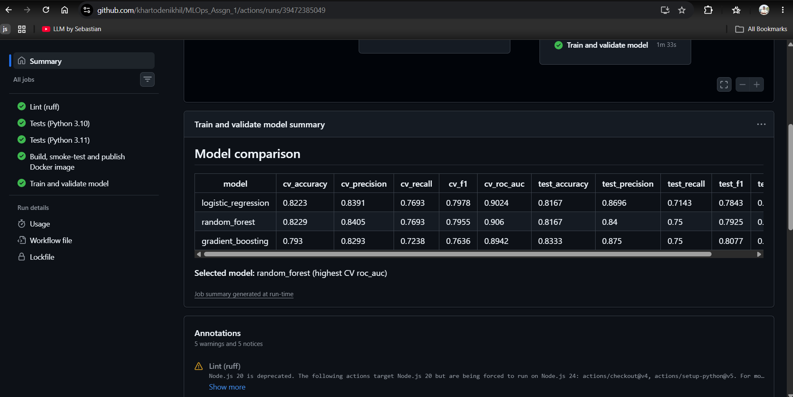

**Challenge encountered:** the first CI training run failed with `ImportError: FallbackAsyncAdaptedQueuePool`. MLflow 2.17 does not pin SQLAlchemy, so the clean CI environment installed a newer, incompatible SQLAlchemy. Pinning `sqlalchemy==2.0.36` fixed it. This shows why CI builds a fresh environment, and that pinning direct dependencies alone is not enough.

---

## 9. Model Serving and Containerisation

**API (`src/api/`, FastAPI):**

| Method | Path | Purpose |
|---|---|---|
| GET | `/health` | 200 when the model is loaded, 503 otherwise (used by probes) |
| GET | `/model/info` | Model metadata and test metrics |
| POST | `/predict` | Single patient: prediction, label, probability, confidence |
| POST | `/predict/batch` | Up to 100 patients |

Pydantic validates input with the same ranges and categories as the data checks, so invalid or unknown fields return **422**. `ca` and `thal` are optional and imputed when missing.

**Docker:** a multi-stage build installs only the serving dependencies (no MLflow or Jupyter). The image runs as a non-root user, has a `HEALTHCHECK` on `/health`, and is configured through environment variables (`MODEL_PATH`, `PREDICTION_THRESHOLD`).


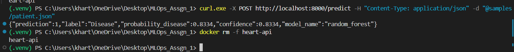

---

## 10. Kubernetes Deployment

The manifests are in `k8s/` and are applied with `kubectl apply -k k8s`:
- **Deployment:** 2 replicas, a rolling update with `maxUnavailable: 0` for zero downtime, CPU and memory requests and limits, and a non-root, read-only, capability-free container.
- **Probes:** a startup probe allows time for the model to load, a readiness probe removes unhealthy pods from traffic, and a liveness probe restarts stuck containers.
- **Service:** a `LoadBalancer` on port 8080.
- **Configuration:** a Kustomize-generated ConfigMap. Changing `PREDICTION_THRESHOLD` triggers an automatic rolling update, which can be rolled back with `kubectl rollout undo`.

Verified behaviours: traffic is spread across both pods (the `/` endpoint reports the serving pod), a deleted pod is automatically replaced, and the deployment scales and rolls back.

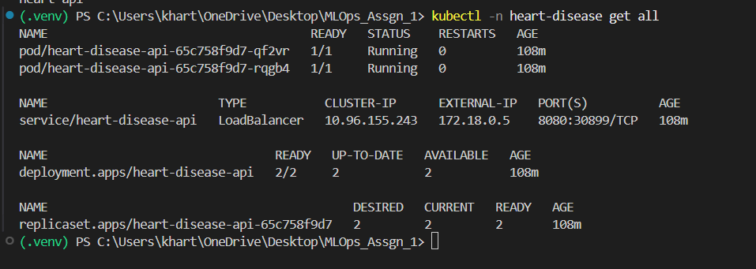
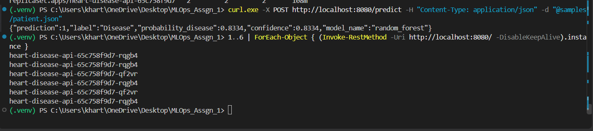

---

## 11. Monitoring and Logging

- **Logs:** JSON lines with a request ID: an access log (method, path, status, latency) and a prediction log (input features, class, probability).
- **Metrics (`/metrics`):** request count and latency per endpoint and status, predictions per class, a histogram of predicted probabilities, and model-loaded and model-info gauges.
- **Prometheus and Grafana** (`k8s/monitoring/`): Prometheus discovers API pods through the Kubernetes API. The Grafana dashboard shows traffic, latency percentiles, error rate, prediction distribution and requests per pod.
- **Alerts:** pod down, model not loaded, 5xx rate above 5%, p95 latency above 500 ms, and a prediction-distribution shift (more than 80% "Disease"), as a simple data drift signal.


---

## 12. Conclusions and Lessons Learned

- Putting preprocessing inside the model pipeline was the single most useful design decision. It removed a whole class of training/serving bugs.
- CI that rebuilds from scratch caught a real dependency problem that never appeared locally.
- Validation at every boundary (data load, API input) turns silent bad predictions into clear errors.
- **Limitations:** the dataset is small (297 rows), so the CV standard deviations are significant and small metric differences between models may be noise. The model is for coursework only and is not suitable for clinical use.
- **Future work:** a full lock file for all transitive dependencies, automatic retraining when drift alerts fire, and a canary deployment of new model versions.

---

**Repository:** https://github.com/<your-username>/MLOps_Assgn_1
